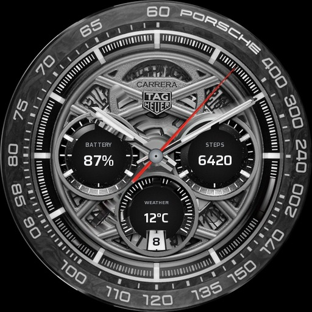
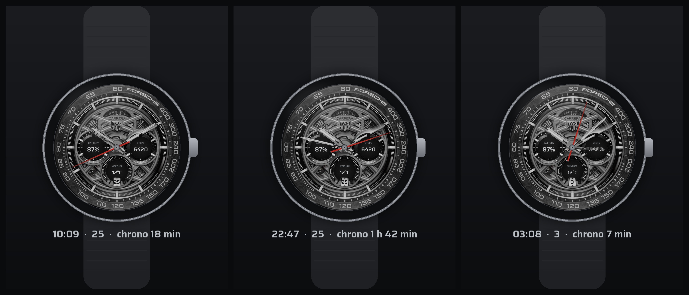

# TAG Heuer Carrera Chronograph × Porsche 963 — WatchMaker face

`Carrera_Porsche963.watch` is a ready-to-import WatchMaker watch face built from a
photograph of the **CBU2010.FT6267** (Carrera Chronograph x Porsche 963).



Three moments of the live face (`mockup.jpg`) — hands, chrono registers and date all
driven by the tags in the table below:



## Import

1. Copy `Carrera_Porsche963.watch` to your phone.
2. Open **WatchMaker**, tap **+ → Import** (or *My Watches → ⋮ → Import*) and pick the file.
3. Save it as your watch face, then send it to the watch as usual.

WatchMaker Studio can open the same file on desktop (*File → Import .watch*).

## What is live

| Element | Binding |
| --- | --- |
| Hour / minute hands | `{drh}` / `{drm}` |
| Central red chronograph seconds | `{drss}` (smooth) |
| 9 o'clock dial | **battery** — `{blp}` (e.g. `87%`) |
| 3 o'clock dial | **steps** — `{ssc}` |
| 6 o'clock dial | **weather** — `{wtd}` (e.g. `12°C`) |
| Date aperture | `{dd}` in a bundled Saira SemiBold |

The printed scales inside the three small dials are **erased in the plate itself**
(the interiors are repainted as clean black discs with matched grain), so each readout
sits on plain black in the centre of its ring — no overlay disc is used. The 6 o'clock
repaint deliberately stops short of the date aperture so the printed cream window and
its black frame survive.

**Bright vs ambient.** The face ships two plates: `.img1.png` (the photo, `display="b"`)
and `.img2.png`, a gamma-lifted copy (`display="d"`). Watches darken everything in
ambient mode, so the dim plate is pre-brightened — without it the face reads as almost
black on the wrist. Hands stay at 80 % opacity in dim mode.

Swapping a readout is one edit in `build_watch.py` (`READOUTS`): e.g. `{pblp}` for the
phone battery, `{stsc}` for the step target, `{wct}` for the weather description.

## How it was made

The dial is **the original photograph**, not a redraw: every hand was cut out as an
RGBA sprite, the plate behind it was reconstructed, and the printed date digit was
erased so a real date can be drawn over the cream plate.

* `build/plate5.py` — measures the hand swaths, removes them (angular interpolation
  around the dial centre / sub-dial centres, flattens the black sub-dial interiors with
  a per-radius percentile, Telea in-paint for leftovers), erases the printed day digit,
  and cuts the hand sprites with the pivot centred.
* `build/build_watch.py` — trims the sprites, makes the 2048² circular plate,
  writes `watch.xml`, renders `preview.jpg` / `preview_dim.jpg` and zips the `.watch`.

Render a still of the packaged face, or a device mockup:

```bash
python3 render_face.py out.png --time 22:47 --date 25 --chrono 1:42 --size 640
python3 mockup.py mockup.jpg
```

Rebuild (needs `opencv-python`, `numpy`, `Pillow`):

```bash
cd watchfaces/build
python3 build_watch.py            # writes ../Carrera_Porsche963.watch
```

`source/cbu2010-ft6267.jpg` is the reference photo; override with `$WATCH_SRC`, and
`$WATCH_WORK` to change the scratch directory (default `/tmp/out/final`).

## Known deviations from the photo

* The date window shows today's date in Saira SemiBold (text size 20) instead of the
  printed "8", so two-digit days fit the narrow aperture.
* The three chronograph registers became battery / steps / weather readouts, as asked.
* The hands are cut by their measured silhouette, so the openworked cut-outs of the
  real hands stay open — the dial shows through them as on the actual watch.
* The sliver of dial that sat under each hand was reconstructed; the dynamic hands
  cover those areas again in normal use.
* Hands are drawn at the photo's exact axes in `preview.jpg` only as a still pose.
